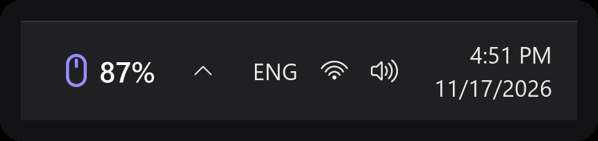

# 🖱️ TrayMouse

**Your wireless mouse battery, right on the Windows taskbar.**
No vendor software, no tray clutter, no surprises when your mouse dies mid-game.

<p align="center">
  
</p>

- 🔋 **Always visible.** A tiny mouse icon and the battery percentage, sitting right next to your tray.
- 🎨 **Any color you like.** Right-click → *Mouse color…*
- 🔴 **Low battery warning.** Below 25% the mouse and the number turn red.
- ⚡ **Charging indicator.** Plug in the cable and you get a bolt plus the current level.
- ❌ **Connection status.** A red ✕ when the receiver is unplugged or the mouse is off.
- 🎮 **Stays out of your way.** Hides automatically over fullscreen games and videos.
- 🪶 **Tiny.** One ~450 KB `.exe`, about 12 MB of RAM, nothing to install.

**What's new in v1.0.3:** the widget now stays where you put it when tray icons come and go. See the [changelog](CHANGELOG.md).

## Download

**Option 1: the exe.** Grab **`traymouse.exe`** from the [latest release](../../releases/latest) and double-click it. That's it.

**Option 2: npm.** If you have [Node.js](https://nodejs.org), one command puts it on your taskbar ([npm package](https://www.npmjs.com/package/traymouse)):

```bash
npx traymouse
```

Running it again while TrayMouse is already up does nothing, so you never get two. npx keeps the copy it downloaded; to get the newest version, run `npx traymouse@latest`.

> Windows SmartScreen may warn you because the app isn't code-signed (signing costs money).
> Click **More info → Run anyway**, or build it yourself from source (see below).

**Start with Windows:** press `Win + R`, type `shell:startup`, and put a shortcut to `traymouse.exe` in that folder (or a `.cmd` file containing `npx traymouse`).

## Supported mice

| Mouse | Status | How the battery is read |
|---|---|---|
| **LAMZU Maya X** (8K dongle) | ✅ Tested (receiver and cable)| The same request LAMZU's official web driver ([lamzu.net](https://www.lamzu.net)) sends to the dongle. |
| **Logitech G Pro Wireless** | ✅ Tested (receiver and cable) | Logitech's HID++ 2.0 protocol, battery voltage feature (`0x1001`), converted to a percentage. |
| **Logitech G Pro X Superlight** | 🧪 Untested | Same protocol and battery feature as the G Pro Wireless, so it's very likely to work. |
| **Logitech G Pro X Superlight 2** | 🧪 Untested | HID++ 2.0 unified battery feature (`0x1004`), which reports a percentage directly. |
| **Razer Viper V3 Pro** | 🧪 Untested | Razer's control protocol (battery `07 80`, charging `07 84`), wired or HyperSpeed dongle. |
| **Razer DeathAdder V3 Pro** | 🧪 Untested | Same as the Viper V3 Pro. |

Other Logitech mice on a Lightspeed receiver will often work too, since they speak the same protocol.

**How the untested mice were added:** they were written from the protocol work of two well-known open-source projects, [Solaar](https://github.com/pwr-Solaar/Solaar) for Logitech and [OpenRazer](https://github.com/openrazer/openrazer) for Razer. The device IDs, commands and checksums come from their drivers, so they're not guesses, but nobody has run them on that exact mouse yet. If you own one, please [tell me whether it works](../../issues/new/choose). One quick report moves it to ✅.

If several supported mice are connected, TrayMouse shows the first one that's switched on.

### Want your mouse supported?

**I'm happy to add new mice on request.** [Open a mouse request](../../issues/new/choose) with the model name, and I'll take it from there. Feedback, bug reports and ideas are all welcome.

## Usage

| Do this | To |
|---|---|
| **Drag** the widget | move it anywhere on the taskbar (it's remembered). Drop it next to the tray and it follows the tray icons; drop it anywhere else and it stays put |
| **Right-click** → *Refresh now* | read the battery immediately (it also refreshes every 5 seconds) |
| **Right-click** → *Mouse color…* / *Reset color* | change the mouse icon's color |
| **Right-click** → *Reset position* | put it back next to the tray |
| **Right-click** → *Quit* | close TrayMouse |

## Privacy

TrayMouse is **100% open source**, and **it collects no data at all**. It has no network code: no telemetry, no analytics, no update checks, no accounts. It only talks to your mouse's USB receiver. Your color and position are saved in two small text files in `%APPDATA%\TrayMouse`.

## Good to know

- **Windows 10 and 11**, with the taskbar at the bottom of the main screen. The text is white, so it looks best on a dark taskbar.
- **Voltage-based mice** (G Pro Wireless, original Superlight) report a voltage, not a percentage, so the number is an estimate (±10%). Right after unplugging the charger it reads a little high and settles over the next 30–60 minutes.
- **Logitech G HUB** may show a different number for those mice, because G HUB estimates battery from its own usage timers instead of reading the battery.
- Windows 11 doesn't allow apps inside the taskbar, so TrayMouse floats just above it and hides itself when a fullscreen app is in front.

## Build from source

```bash
cargo build --release
```

Needs [Rust](https://rustup.rs). On the MSVC toolchain you also need the Windows SDK. Without it, the GNU toolchain works too:

```bash
rustup toolchain install stable-x86_64-pc-windows-gnu
cargo +stable-x86_64-pc-windows-gnu build --release
```

To run the tests, use `cargo test`. With a supported mouse connected, `cargo test -- --ignored reads_real_mouse` also checks it on real hardware.

The mouse protocols live in [`src/mice.rs`](src/mice.rs), with one short section per brand, so adding a mouse is usually a few lines.

### Publishing a new version (maintainers)

Bump `version` in `package.json` and `Cargo.toml`, build the release exe, copy it to `bin/traymouse.exe`, then run `npm publish`. Also attach the same exe to a GitHub release.

## Credits

Protocol knowledge from [Solaar](https://github.com/pwr-Solaar/Solaar) (Logitech) and [OpenRazer](https://github.com/openrazer/openrazer) (Razer). Thank you to everyone who reverse-engineered these mice.

## License

[MIT](LICENSE)
